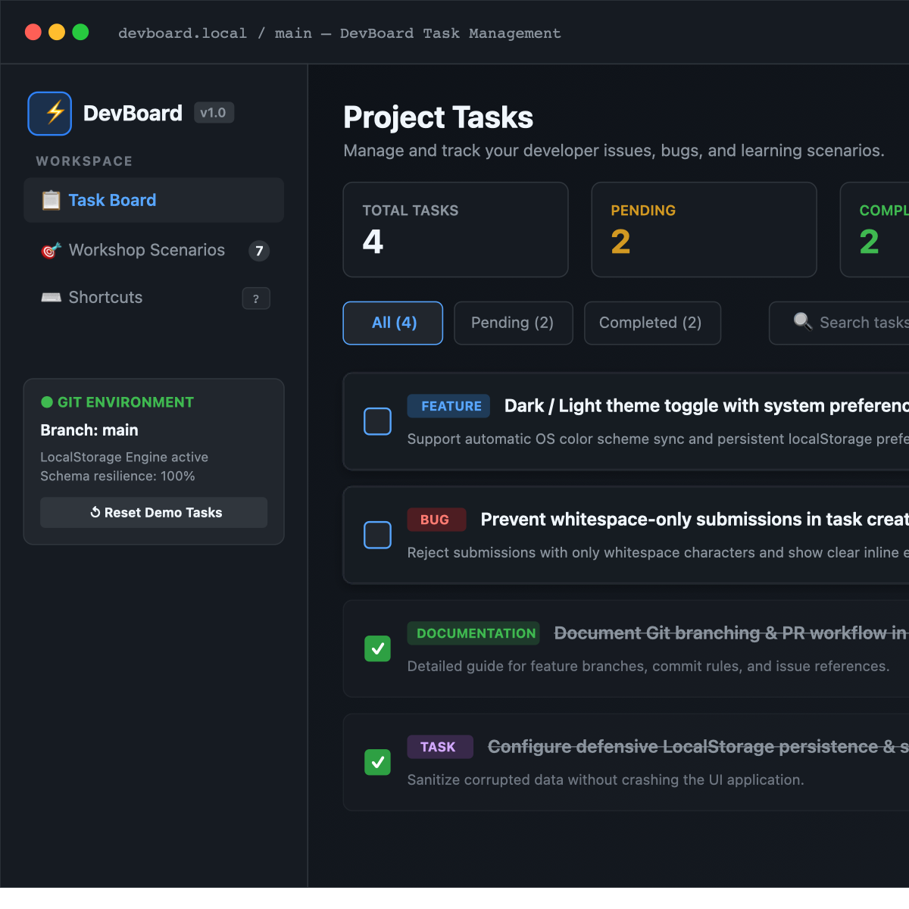
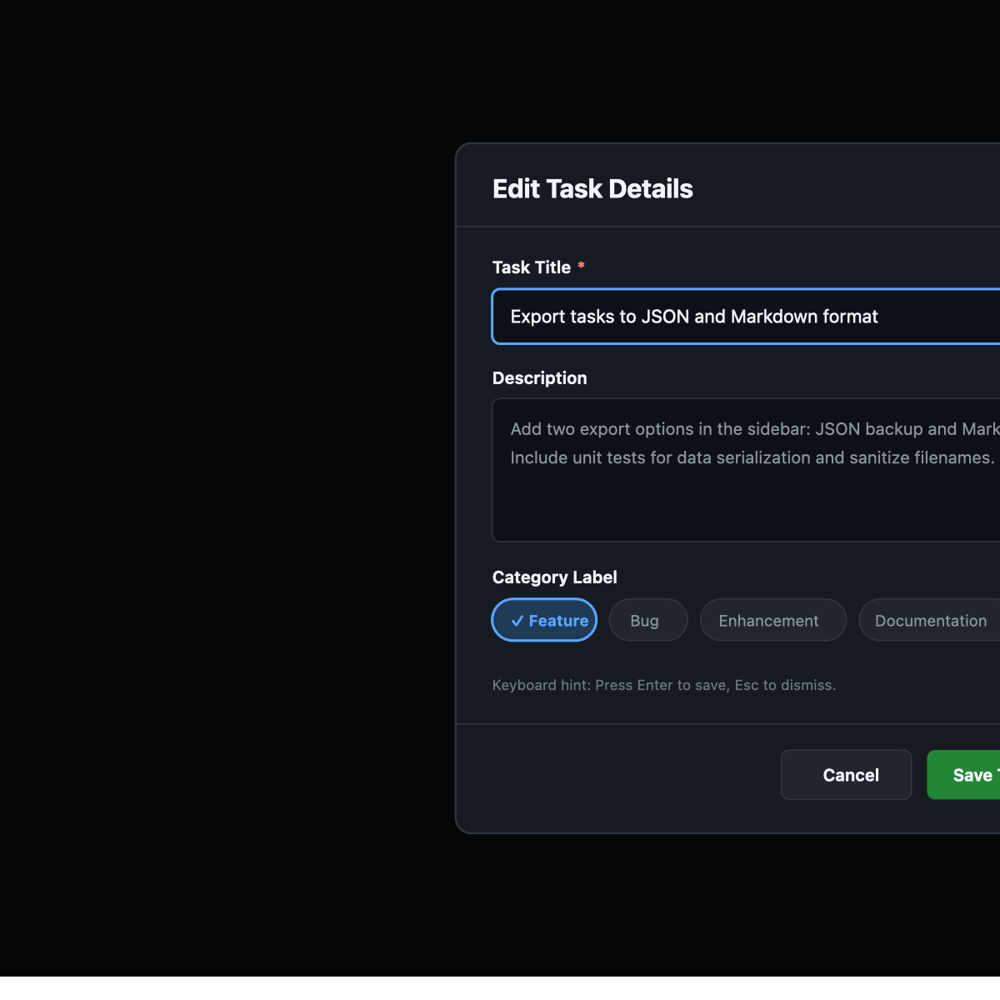
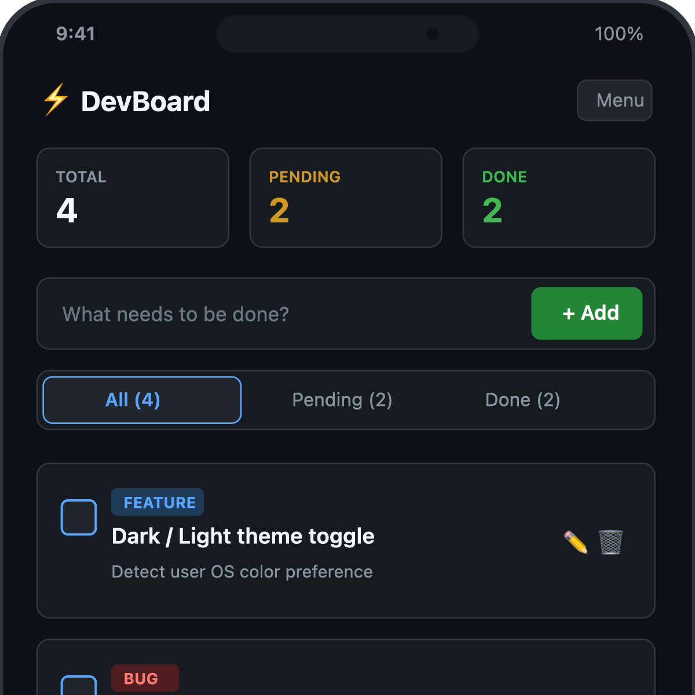
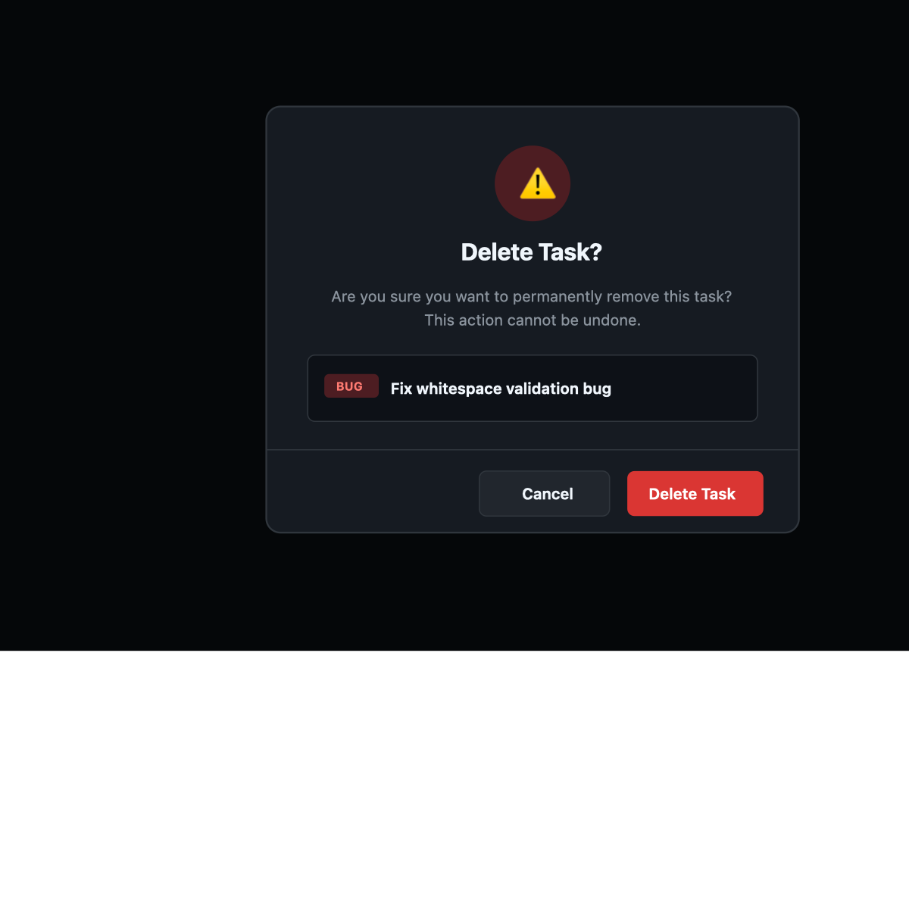

# DevBoard ⚡

> A clean, developer-oriented task management web application designed as a practical learning project for **Git**, **GitHub**, branching workflows, Pull Requests, and collaborative code reviews.

---

## 1. Project Overview

**DevBoard** is a polished, lightweight task management tool built with vanilla web technologies. It is deliberately engineered without heavy frameworks or build tools so that students, workshop participants, and junior engineers can focus on core software engineering practices:

- How to structure clean, maintainable modular code without a framework.
- How to create feature branches, atomic commits, and descriptive Pull Requests.
- How to write structured GitHub Issues using templates.
- How to conduct respectful, high-quality code reviews.
- How to test for accessibility, defensive input validation, and edge-case resilience.

---

## 2. Screenshots

<!-- 
Screenshot Placeholders:
Add high-resolution screenshots here after cloning and running the application in your local environment.
-->

| Desktop Task Board View | Task Creation & Filter Interaction |
| :---: | :---: |
| <br>*(Placeholder: Main dashboard showing stats, task list, and developer sidebar)* | <br>*(Placeholder: Filter toolbar, search query, and edit modal)* |

| Mobile Responsive View | Delete Confirmation Dialog |
| :---: | :---: |
| <br>*(Placeholder: Stacked mobile view with 44px tap targets)* | <br>*(Placeholder: Accessible confirmation modal for task deletion)* |

---

## 3. Key Features

### 📋 Task Management
- **Create Tasks:** Title (required, validated against whitespace-only submissions), optional description, and categorized labels (`task`, `feature`, `bug`, `enhancement`, `documentation`).
- **Status Toggle:** Instantly mark tasks as pending or completed with an accessible checkbox.
- **Edit Tasks:** Update task title, description, and label via a dedicated modal dialog with focus trapping.
- **Delete Confirmation:** Prevent accidental loss through an accessible confirmation modal.
- **Input Validation:** Clear inline error messages and visual warnings when attempting to submit blank or invalid titles.
- **Defensive Persistence:** Tasks persist in browser `localStorage`. Malformed or corrupted entries are caught and sanitized gracefully without crashing.

### 🔍 Filtering, Search & Metrics
- **Segmented Filters:** Filter view by **All**, **Pending**, or **Completed** tasks with dynamic counter badges.
- **Live Search:** Fast, case-insensitive keyword filtering matching titles, descriptions, and labels.
- **Synchronized Statistics:** Real-time counters for Total, Pending, and Completed items, plus an animated progress bar.
- **Informative Empty States:** Clear contextual feedback when no tasks exist or when search/filter yields zero results.

### 🎨 Developer-Centric UX & Accessibility
- **Dark-First Theme:** Clean contrast inspired by GitHub's dark interface, subtle borders, and monospace accents.
- **Zero Build Tools:** Runs immediately in any modern browser using native ES modules.
- **Keyboard Shortcuts:**
  - <kbd>N</kbd> — Jump to create task input
  - <kbd>/</kbd> — Focus the search bar
  - <kbd>Esc</kbd> — Close any open modal dialog
  - <kbd>?</kbd> — Open the keyboard shortcuts guide
- **Screen Reader Friendly:** Semantic HTML5 (`<header>`, `<main>`, `<article>`, `<aside>`), ARIA labels, and live announcement regions.
- **Toasts:** Non-intrusive feedback notifications for creates, updates, status toggles, and deletions.

---

## 4. Technology Stack

- **HTML5:** Semantic document structure, accessible form elements, dialogs, and ARIA attributes.
- **CSS3:** Custom properties (design tokens), flexbox, CSS grid, media queries, and dark-mode styling.
- **JavaScript (ES6+):** Pure vanilla JavaScript organized into modular ES modules (`storage.js`, `tasks.js`, `ui.js`, `app.js`).
- **Persistence:** Browser `localStorage` API with defensive JSON schema parsing.
- **Version Control:** Git & GitHub with issue templates, pull request templates, and workflow documentation.

---

## 5. Prerequisites

To run and contribute to DevBoard, all you need is:
- A modern web browser (Google Chrome, Mozilla Firefox, Microsoft Edge, or Apple Safari).
- [Git](https://git-scm.com/) installed on your machine.
- A code editor (such as VS Code, Sublime Text, or Neovim).
- *(Optional)* Python 3 or Node.js if you prefer serving files over a local HTTP server.

---

## 6. Running Locally

Because DevBoard uses native **ES Modules** (`type="module"`), browsers require files to be served via an HTTP server rather than the `file://` protocol to satisfy CORS policies.

Choose any of the simple options below:

### Option A: Using VS Code Live Server (Easiest)
1. Open the project folder in VS Code.
2. Install the **Live Server** extension (`ritwickdey.liveserver`).
3. Click **"Go Live"** in the bottom status bar or right-click `index.html` and select **"Open with Live Server"**.

### Option B: Using Python (Built into macOS / Linux / Windows)
Open your terminal in the `devboard` folder and run:

```bash
# Python 3.x
python3 -m http.server 8000
```

Then open `http://localhost:8000` in your browser.

### Option C: Using Node.js (`npx serve`)
```bash
npx serve .
```

---

## 7. Project Structure

```text
devboard/
├── index.html                   # Main application markup & accessibility landmarks
├── style.css                    # Design tokens, layouts, responsive rules, dark theme
├── js/
│   ├── app.js                   # Application controller, event orchestration, shortcuts
│   ├── tasks.js                 # Pure domain logic (validation, filtering, statistics)
│   ├── storage.js               # LocalStorage I/O, schema validation & data recovery
│   └── ui.js                    # DOM rendering, accessible modals, toasts, cards
├── README.md                    # Project documentation & workshop scenarios
├── CONTRIBUTING.md              # Contributor guide, Git branching & PR workflow
├── .gitignore                   # Ignores OS files, editor caches, and credentials
└── .github/
    ├── ISSUE_TEMPLATE/
    │   ├── bug_report.md        # Standardized bug reporting template
    │   └── feature_request.md   # Standardized feature proposal template
    └── PULL_REQUEST_TEMPLATE.md # Pull request checklist & closing keywords
```

---

## 8. Workshop Scenarios (Hands-on Git & GitHub Practice)

These realistic scenarios are designed to be created as GitHub Issues during live workshops, team onboarding, or classroom settings. Participants can claim an issue, create a feature branch, submit a PR, and perform peer reviews.

> **Note for Workshop Instructors:**  
> These issues do not exist automatically on GitHub. Have students or instructors create them using the templates in `.github/ISSUE_TEMPLATE/`.

### Scenario 1: Empty task titles are accepted
- **Type:** Bug Report
- **Suggested Label:** `bug`
- **Suggested Branch:** `fix/empty-title-validation`
- **Problem:** Submitting whitespace-only strings creates blank task cards that clutter the board.
- **Expected Behavior:** Submissions with empty or whitespace-only titles should be blocked, the input should remain focused, and an inline error should alert the user.
- **Acceptance Criteria:**
  - Validate input with `rawTitle.trim().length === 0`.
  - Prevent task creation on invalid input.
  - Display accessible error message `#title-error-text`.
  - Clear error as soon as user types valid characters.

### Scenario 2: Filter tasks by completion status
- **Type:** Feature Request
- **Suggested Label:** `enhancement`
- **Suggested Branch:** `feat/status-filter`
- **Problem:** When boards have many items, users need to view only pending tasks or only completed tasks.
- **Expected Behavior:** Clicking "Pending" shows only incomplete tasks; clicking "Completed" shows only finished tasks.
- **Acceptance Criteria:**
  - Filter segmented control updates active state with `aria-pressed`.
  - Task count badges reflect total, pending, and completed counts accurately.
  - Empty state displays a specific message if no tasks match the filter.

### Scenario 3: Add task search
- **Type:** Feature Request
- **Suggested Label:** `enhancement`
- **Suggested Branch:** `feat/task-search`
- **Problem:** Users cannot quickly find a specific task on a long board.
- **Expected Behavior:** Typing in the search bar dynamically filters the list by matching title, description, or label text.
- **Acceptance Criteria:**
  - Real-time search with case-insensitive matching.
  - A clear button appears when search text is present.
  - Helpful message displayed when zero tasks match the search query.

### Scenario 4: Task counts become incorrect after deletion
- **Type:** Bug Report
- **Suggested Label:** `bug`
- **Suggested Branch:** `fix/delete-counter-sync`
- **Problem:** If a user deletes a completed task while on the "Completed" filter, the counters must update immediately.
- **Expected Behavior:** Deleting any task immediately recalculates total, pending, and completed metrics and updates the progress bar.
- **Acceptance Criteria:**
  - Counter values update in the DOM immediately following deletion.
  - Storage is refreshed with the deleted item removed.
  - Confirmation dialog safely cleans up references.

### Scenario 5: Improve mobile responsiveness
- **Type:** Enhancement
- **Suggested Label:** `enhancement`
- **Suggested Branch:** `enhancement/mobile-layout`
- **Problem:** On small mobile screens (< 480px), action buttons may be difficult to tap or layout may overflow horizontally.
- **Expected Behavior:** Form inputs, action buttons, and navigation fold gracefully into a single-column layout with minimum 44px tap targets.
- **Acceptance Criteria:**
  - No horizontal scrolling on mobile viewports.
  - Touch targets for buttons and checkboxes meet mobile accessibility standards (>= 40px–44px).
  - Search box and filters collapse or stack cleanly.

### Scenario 6: Improve local setup instructions
- **Type:** Documentation
- **Suggested Label:** `documentation`
- **Suggested Branch:** `docs/setup-instructions`
- **Problem:** First-time contributors unfamiliar with ES modules might try double-clicking `index.html` and face CORS errors.
- **Expected Behavior:** Documentation provides straightforward options for VS Code Live Server, Python `http.server`, and Node.js.
- **Acceptance Criteria:**
  - Clear explanations of why a local server is needed for ES modules.
  - Copy-paste terminal commands for major operating systems (macOS, Windows, Linux).

### Scenario 7: Add keyboard support and clearer focus indicators
- **Type:** Accessibility
- **Suggested Label:** `accessibility`
- **Suggested Branch:** `a11y/keyboard-navigation`
- **Problem:** Keyboard-only users need high-contrast focus rings and intuitive navigation shortcuts.
- **Expected Behavior:** Pressing <kbd>N</kbd> jumps to the task title input, pressing <kbd>/</kbd> focuses search, and pressing <kbd>Esc</kbd> closes any open dialog.
- **Acceptance Criteria:**
  - High-contrast `:focus-visible` styling on all interactive controls.
  - Focus trapped or managed within open modal dialogs.
  - Focus returns to the triggering button when a modal is dismissed.

---

## 9. Manual Verification Checklist

Before opening a Pull Request or tagging a release, run through this concise checklist:

- [ ] **Task Creation:** Create a task with title and description. Confirm it appears at the top of the list.
- [ ] **Empty Validation:** Attempt to create a task with an empty string or spaces only. Verify creation is blocked and error is displayed.
- [ ] **Toggle Completion:** Check the checkbox on a pending task. Verify title styles update and counters refresh.
- [ ] **Task Editing:** Open the edit modal on a task, change the title/label, and save. Verify updates appear immediately.
- [ ] **Task Deletion:** Click delete, confirm in the dialog. Verify task is removed and counters decrement.
- [ ] **Persistence:** Refresh the browser tab (<kbd>Cmd+R</kbd> or <kbd>F5</kbd>). Verify all tasks, completed states, and edits persist.
- [ ] **Filters & Search:** Switch between All, Pending, and Completed filters. Type search queries and test the clear button.
- [ ] **Responsive Test:** Resize browser window to mobile width (375px) and tablet width (768px). Check layout integrity.
- [ ] **Console Inspection:** Open Developer Tools (<kbd>F12</kbd>) and verify there are zero unhandled exceptions or console errors.

---

## 10. Current Limitations & Future Ideas

### Current Limitations
- Persistence is client-side only (stored in browser `localStorage`). Tasks are not synchronized across different devices.
- No backend authentication or multi-user access (deliberately kept simple for beginner workshops).

### Ideas for Future Workshop PRs
- [ ] Export and import tasks as a JSON file.
- [ ] Drag-and-drop task reordering.
- [ ] Due date picker with "Overdue" visual indicator.
- [ ] Filter by label tag (`bug`, `feature`, `documentation`).
- [ ] Dark / Light mode toggle switch.

---

## 11. Contributing

Contributions are warmly welcomed! Please read our [CONTRIBUTING.md](file:///Users/tusharrr0302/.gemini/antigravity-ide/scratch/devboard/CONTRIBUTING.md) for full instructions on forking, branching conventions, and Pull Request guidelines.

---

## 12. License

*(License Placeholder: A formal open-source license such as MIT or Apache 2.0 will be selected upon release. Until then, all rights are reserved.)*
